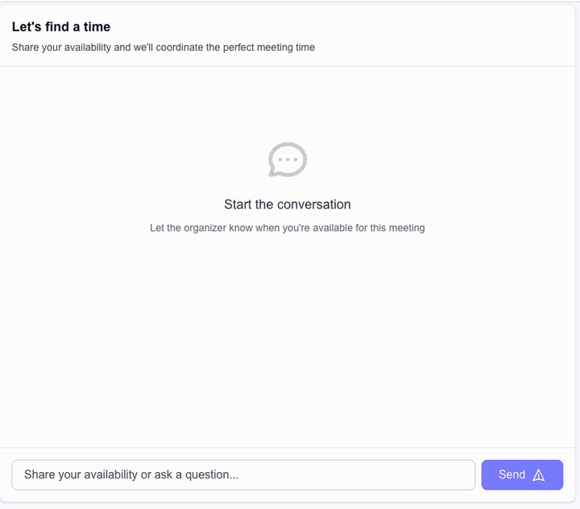
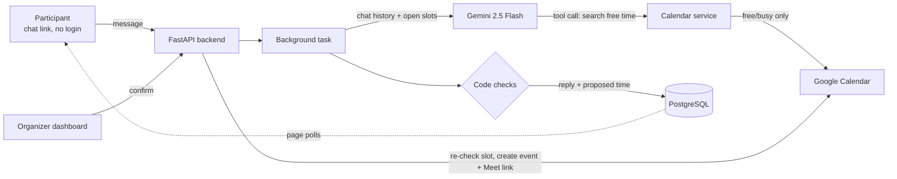

# AI Meeting Scheduler

**Book a meeting through a short chat, without showing anyone your calendar.**

> Built late 2025 · Source private

*Automated test run: a participant who keeps changing their mind. Monday, then Tuesday, then Wednesday, then booked.*

**Full demo (48 seconds)** covers creating a request, the participant picking a time in chat, the organizer confirming, and the Google Meet invite.

https://github.com/user-attachments/assets/fbff4410-2097-4fad-9ff0-461f302793ac

## Purpose

**Hypothesis:** booking links that show every open slot work against you. Too much choice makes people put off booking, and an easy pick is an easy cancel or reschedule.

A conversation books better. The other person says what suits them, the assistant agrees a time in a few messages, and they leave with a booked time. As a side effect, nobody sees anyone's calendar.

## What it does

1. **The organizer** connects Google Calendar and creates a request: title, length, video or phone.
2. **The participant** opens a link (no account needed) and chats with an assistant: *"How does the week after next look?"*
3. **The assistant** checks the organizer's calendar privately. It lets the participant suggest a time first, and offers 2–3 options only if that doesn't work. It never says what the organizer is doing.
4. **The organizer** reviews the agreed time and confirms with one click. The event and a Google Meet link go on their calendar, and the participant gets the invite.

## Architecture

The approach, in five decisions:

- **Only a person can book.** The assistant has no tool that books anything. It can only record a proposed time. The organizer's one-click confirm is the only path that writes to a calendar.
- **The model sees free time, never the calendar.** Its only tool returns open slots for a date range. Event titles, attendees and busy reasons never reach the model, so it can't leak them.
- **Code checks what the prompt can't guarantee.** Contact details the model records must appear in the conversation. When the organizer confirms, the slot is checked again against the live calendar before anything is booked.
- **Replies run in the background.** Each message starts a background task, so a slow model call never blocks the page, and every model and tool call is traced in Langfuse.
- **Tested as real conversations.** Over 60 end-to-end tests drive the real chat in a browser: vague availability, timezone mix-ups, counter-offers, a participant who keeps changing their mind. A second model grades each reply against what it should have said.

| Part | Choice |
|---|---|
| Assistant | Gemini 2.5 Flash with function calling |
| Backend | FastAPI, PostgreSQL, Redis |
| Frontend | Next.js, TypeScript |
| Calendar | Google Calendar API (OAuth) |
| Tracing | Langfuse |
| Hosting | Railway |

## Outcome

Built and running end to end. The test of the hypothesis compares chat booking against a standard booking link:

| Metric | What it tests | Result |
|---|---|---|
| Share of people who book after opening the link | Whether people book at all | Pending |
| Time from link opened to booked | Whether chat is faster | Pending |
| Cancel or reschedule rate | An easy pick is an easy cancel | Pending |

## What I learned

- **Choosing the model mattered more than rewording the prompt.** I tested five models on the same agent. One confirmed meetings it had no right to confirm; another said "let me check" and never checked. The replies read fine, and only the Langfuse traces showed the missing tool calls. Gemini 2.5 Flash gave the best mix of reliable tool calling and cost. Claude Sonnet was the most reliable but cost more than this needed.
- **Spell out what counts as a yes.** The assistant offered 3:30 instead of 3:00, the participant replied with their email, and the model took that as agreement. Models infer intent from nearby actions, so the prompt now says plainly that sharing contact details is not accepting a new time.
- **Anything that must be right comes from code.** Told not to invent contact details, the model still wrote emails like `sarah@example.com`. Models reach for the same fakes every time (`example.com`, `John Doe`, `555-1234`), so code blocks them and checks that any email or phone number appears in the conversation. Links work the same way: code inserts every link, because the model sometimes writes one that looks right and goes nowhere.
- **Small settings change behaviour.** Without today's date, "next Tuesday" landed on the wrong day. At the default temperature the model invented details; at 0.2 it stayed factual, which matters more than charm when the output lands in a calendar.

---

More about me at [shrikantvarma.com](https://shrikantvarma.com).
